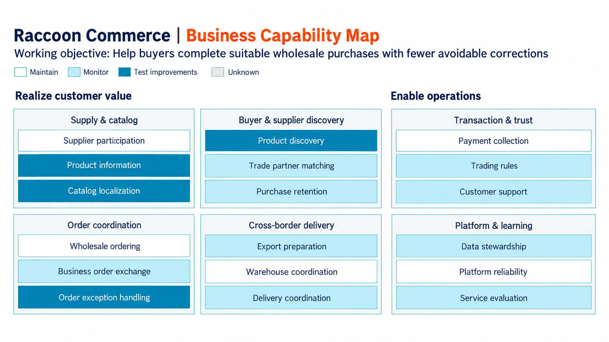
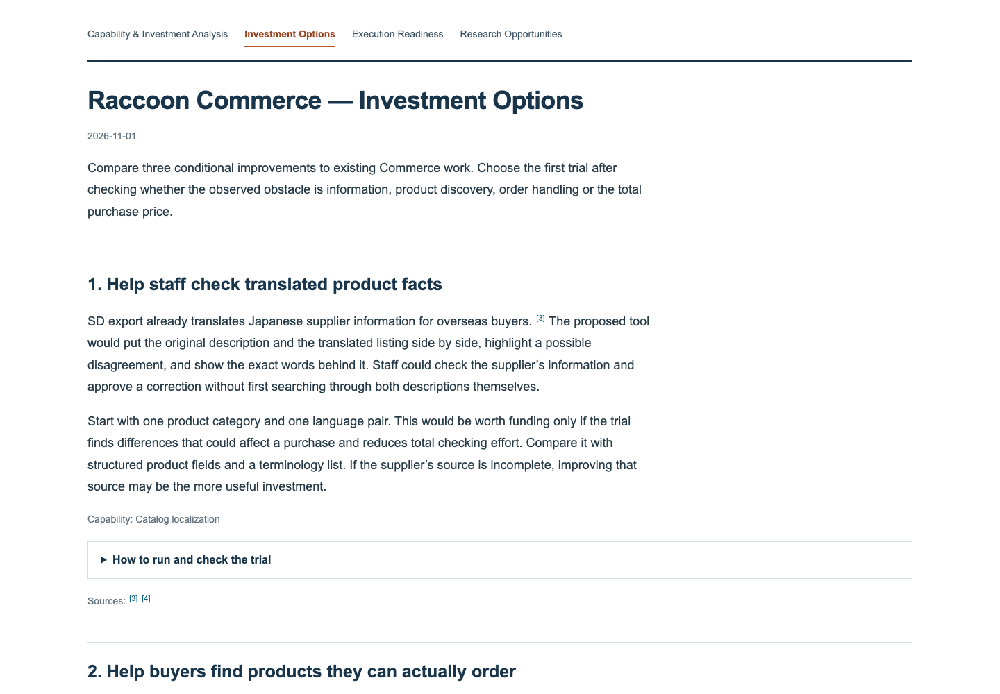

# BCM Skills

Turn a company URL or internal documents into a report on **which work is worth improving, what you could build, and how to test whether it helps**.

**[Open the live TSMC demo](https://yangnim21029.github.io/bcm-skills/)** — a new public-source report made with the current skills, with a capability map, investment options, execution conditions and research opportunities. Its proposed improvements are independent analysis, not TSMC-approved investments.

These two agent skills research an organization, map the work it performs, and develop investment options with evidence, implementation conditions and research papers. Investment means committing staff time, software spending or development effort to an improvement.

A business capability is work an organization needs to perform, such as maintaining product information or resolving an order problem. Grouping evidence under those names lets you compare a new tool, a process change and an existing service against the same task.

- [See a real example](#example-raccoon-commerce)
- [Create your first report](#create-your-first-report)
- [Use the report to plan a prototype](#build-on-the-report)
- [Inspect the scripts and contracts](#scripts-and-output-contracts)

## What you can use it for

- **Decide which improvement to investigate.** Start with a company or business unit. Compare the work that could change, the evidence of a problem, existing tools and simpler alternatives.
- **Prepare a product or pilot brief.** Describe what a person supplies, what a proposed tool displays, what the person does next, and what result would justify further development.
- **Check implementation needs.** Identify the records, permissions, responsible people and recurring maintenance needed to make an option work.
- **Find research worth reading.** Search arXiv for methods relevant to the mapped tasks. Keep the exact queries, reading depth, limitations and unsuitable results alongside the promising papers.
- **Revisit a decision with better evidence.** Add customer cases, workflow records or costs, then revise the affected capabilities and options while keeping the rest of the map stable.

The skills produce analysis and HTML reports. You can use their findings to specify an application; building and deploying that application is a subsequent engineering task.

## Example: Raccoon Commerce

A public-source run on [Raccoon Commerce](https://www.raccoon.ne.jp/en/commerce/), completed on 1 November 2026, produced **18 capabilities, 3 conditional investment options and 10 research papers**. It covered wholesale trading, international delivery and adjacent ordering services.



The colors show proposed attention under the stated objective: maintain existing work, monitor it, or test an improvement. They do not measure current maturity or forecast returns. This is an independently generated analysis, not a company-approved roadmap.

The report developed three possible applications:

1. **A product-information checking tool.** Place a supplier’s Japanese description beside its translated listing and highlight a possible difference in a measurement, material or quantity. Staff inspect the supporting words and approve a correction. Test whether this reduces total checking effort without missing more errors that could affect a purchase.
2. **A product finder that checks purchase conditions.** Retrieve products matching the buyer’s request and show the supplier conditions that affect whether the buyer can order them. Compare the proposed experience with existing recommendations and filters, then follow buyers through accepted, paid orders and subsequent cancellations.
3. **An order-support workspace.** Bring together dated order events, warehouse or carrier updates, and the customer’s message. Staff identify the missing information and the next person who can act. Measure handling effort and confirmed resolutions, including cases that remain open.

These are proposed extensions to existing services. SD export already provides translation, and SUPER DELIVERY has announced AI recommendations of Japanese manufacturers. The [SD export description](https://www.raccoon.ne.jp/en/service/sdexport) and [recommendation announcement](https://www.raccoon.ne.jp/news/press/2025/42538142356) establish those starting points.

The research also changed the investment argument. Raccoon’s quarterly presentation identifies overseas shipping costs as a first-purchase barrier, particularly for inexpensive, lightweight orders. Better search may leave that cost barrier untouched, so the report compares information problems with purchase economics before proposing a software trial. See the [FY2027 first-quarter presentation, slide 22](https://pdf.irpocket.com/C3031/xoA3/M9fy/Dl43/Lxsf.pdf#page=22).



The example’s research inventory retained all 10 retrieved papers: 3 worth reading, 2 conditional leads, 3 background papers and 2 unsuitable results. Three papers received selected-section full-text checks; the other seven were assessed from their original abstracts and metadata. These counts describe this run, not a required report size.

## What a full report contains

Four linked English HTML pages form the default deliverable:

1. **Capability & Investment Analysis — `index.html`.** The generated capability map, business scope, objectives and evidence. Use it to understand where a proposed change fits in the organization.
2. **Investment Options — `investment-options.html`.** Each proposed improvement, the work it changes, a simpler comparison, execution details and conditions for continuing or stopping. Use it to choose what to test next.
3. **Execution Readiness — `readiness.html`.** The people, data, permissions and engineering conditions each option needs. Use it to identify the work required before a trial can begin.
4. **Research Opportunities — `research-opportunities.html`.** A plain paper-comparison table with exact searches, scope, reading depth and inclusion or exclusion reasons. Use it to choose papers to read and methods to examine.

Small inline citations open the original excerpt, its location, surrounding context, interpretation limits and source link. The capability map is a generated landscape image; supplementary Mermaid diagrams explain handoffs or approval steps where useful.

Internal JSON models, source snapshots and review records support revision. The reader-facing deliverable remains the HTML pages and their image assets. A narrower request, such as a capability map alone, keeps its requested scope.

## Create your first report

Use an agent host with web research, local file and Python execution, and image-generation tools. The skills supply instructions, references and rendering scripts; the host supplies those tools. Python renderers use the standard library.

For a fresh project installation, run this from your project directory:

```sh
git clone https://github.com/yangnim21029/bcm-skills.git
mkdir -p .agents/skills
cp -R bcm-skills/bcm-creator .agents/skills/
cp -R bcm-skills/ai-opportunity-radar .agents/skills/
```

Codex discovers project skills under `.agents/skills/`. For an installation shared across projects, use `~/.agents/skills/`. See the [official local skill documentation](https://learn.chatgpt.com/docs/build-skills#where-codex-loads-local-skills). Other Agent Skills hosts can use the two directories through their supported installation mechanism.

Then give the agent a request such as:

```text
Use $bcm-creator and $ai-opportunity-radar to analyze
https://www.raccoon.ne.jp/en/commerce/.

Skip intake and use public sources. Cover Raccoon Commerce and verify
the boundaries of its services before choosing investment directions.
Compare existing tools and simpler process changes with proposed AI work.

Create the full four-page English report, including the generated
capability-map image and Research Opportunities. Save it under
./raccoon-report/output/. Keep unsupported costs and scores unknown.
```

Open `raccoon-report/output/index.html` in a browser and use its navigation to read the other pages. A new run may differ as sources and available tools change.

You can also begin with an interview:

```text
Use $bcm-creator to assess our university library.
First ask which services and decisions matter, and what workflow records
or internal documents I can provide. Ask in small rounds.
Then prepare the full report for the agreed scope.
```

Useful inputs include the organization’s URL, a selected business unit, a decision to support, existing proposals, representative cases and any documents you are permitted to use. The [intake process](bcm-creator/references/interactive-intake.md) lets you provide these gradually or explicitly skip. Public-only analysis keeps internal costs, capacity and priorities unresolved where evidence is missing.

## Build on the report

Once an option looks worth investigating, use its explanation and readiness conditions to prepare the next task:

```text
Read the product-information checking option in ./raccoon-report/output/.
Turn it into a prototype brief: the staff member’s task, required input
records, what appears on screen, approval steps, failure cases and a test
against the current process. Preserve the report’s evidence limits.
List the decisions still needed before implementation.
```

For a focused research follow-up:

```text
Use the existing capability map to investigate methods for checking
translated product facts. Expand the arXiv search to include simpler
baselines and failure cases. Update Research Opportunities with every
retrieved unique paper, exact queries and honest reading depth.
```

For a decision update using internal evidence:

```text
Use $ai-opportunity-radar with our existing report and the attached
order-support case records. Reassess which work consumes avoidable time,
compare a shared status screen with generated replies, and update the
investment and readiness pages. Keep proposed owners separate from
confirmed assignments.
```

## How the analysis reaches a recommendation

[`bcm-creator`](bcm-creator/SKILL.md) establishes the scope, organizes evidence under capabilities and writes the main analysis. [`ai-opportunity-radar`](ai-opportunity-radar/SKILL.md) compares options and execution conditions. A full brief uses both and automatically includes the research inventory.

The workflow checks existing features and competing explanations before treating an apparent gap as an investment opportunity. It follows an improvement through the information needed, the person making a decision, the authorized action and the confirmed outcome. It also asks who will maintain the work and how the choice changes under a different objective.

Before delivery, the agent rereads the draft for missing explanations, revises unclear passages and checks the rendered pages. When available, `no-ai-slop` supports writing and revision, `academic-research-suite` supports scholarly discovery and verification, and `liteparse` supports document extraction. The core instructions remain usable without those companion skills.

A proposed benefit stays conditional until tested. Unknown scores remain unknown; colors express attention, and numerical charts appear only when supported scores are supplied. Reading a promising paper, running a feasible pilot and approving an investment are separate decisions.

## Scripts and output contracts

For custom workflows, the agent creates a [BCM model](bcm-creator/references/output-contract.md) and a [portfolio model](ai-opportunity-radar/references/portfolio-contract.md) under `records/model/`. Stable capability IDs let you connect new evidence or compare objectives without rebuilding the entire map.

The rendering helpers can then be called from the repository root:

```sh
python3 bcm-creator/scripts/prepare_map_image.py records/model/bcm.json --output-dir records/map
python3 bcm-creator/scripts/render_bcm_input_html.py records/model/bcm.json output/index.html --mermaid-js /path/to/mermaid.min.js
python3 ai-opportunity-radar/scripts/render_radar.py records/model/portfolio.json output/investment-options.html
python3 ai-opportunity-radar/scripts/render_readiness.py records/model/portfolio.json output/readiness.html
```

These commands assume the authoring models and output directory exist. `prepare_map_image.py` prepares exact labels, colors and a prompt. The agent must generate and inspect the image using the [bundled reference workflow](bcm-creator/references/capability-map-visuals.md), then save it at the model’s `map_image` path relative to `output/` before rendering the main page.

The agent also writes the research page and adds shared navigation; the individual renderers do not assemble the four-page report. A local Mermaid bundle supports offline supplementary diagrams. Despite its historical filename, `render_radar.py` renders a value/feasibility matrix when scores are available. Fictional JSON fixtures under `references/` illustrate the schemas.

Run the renderer checks with:

```sh
python3 -m unittest discover -s tests
```

## Method and provenance

The method is informed by Alexander Hoeppe’s Gartner webinar, “Accelerate Your AI Journey With Business Capability Maps.” These skills are independent interpretations, not official Gartner templates. The [research basis](bcm-creator/references/research-basis.md) explains the supporting capability-modeling literature and its limits.

The Raccoon images above are generated report previews from a public-source analysis. The bundled visual reference was supplied by the user and guides composition. Neither a map nor a successful rendering test establishes an investment return. No new license is implied by this documentation update.
